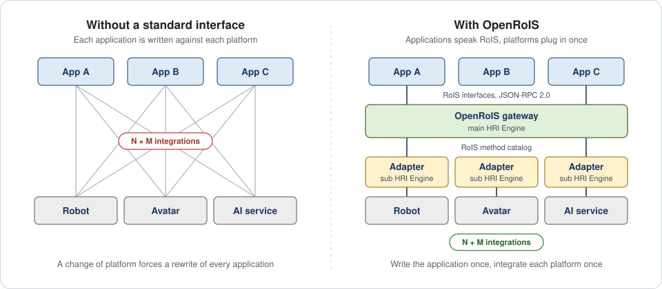
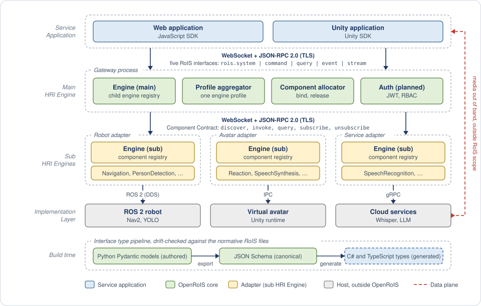

  

<h1 align="center">OpenRoIS</h1>

  <strong>A community-driven open-source middleware implementing the OMG Robotic Interaction Service (RoIS) Framework 2.0</strong> 
  Write a service application once. Run it on physical robots, virtual avatars, and digital services, or let an AI agent drive them.

  
  
  
  
  

  <a href="https://openrois.org/">Website</a> ·
  <a href="https://github.com/openrois">OpenRoIS GitHub Organization</a> ·
  <a href="https://arxiv.org/abs/2609.21178">OpenRoIS arXiv Preprint</a> ·
  <a href="https://www.omg.org/spec/RoIS/2.0">OMG RoIS Specification</a> ·
  <a href="https://github.com/openrois/openrois/tree/dev/docs">Documentation</a> ·
  <a href="https://github.com/openrois/openrois/blob/dev/docs/roadmap.md">Roadmap</a>

---

## Why OpenRoIS

Service applications for human-robot interaction are usually written against the
hardware-specific interface of one platform, so every change of hardware forces a
rewrite. The [OMG RoIS Framework 2.0](https://www.omg.org/spec/RoIS/2.0) solves this
at the level of the standard: applications talk to HRI Engines through five
platform-independent interfaces and exchange symbolic messages such as
"a person was detected" or "navigate to the kitchen".

A specification alone does not provide the maintained implementation, SDKs, and
adapters that adoption requires. **OpenRoIS is that implementation**: community-driven,
open-source, and released under the Apache-2.0 license.

  <picture>
    <source media="(prefers-color-scheme: dark)" srcset="assets/openrois-concept-dark.svg">
    
  </picture>

## What OpenRoIS Provides

- **A recursive engine.** One `Engine` class realizes both the main and the sub HRI
  Engine roles of RoIS, so the gateway and every adapter share a single dispatch
  implementation.
- **One RoIS protocol at every hop.** The RoIS method catalog runs from application to
  gateway, from gateway to adapter, and from engine to component, which keeps the
  engine independent of ROS 2, gRPC, game engines, or any other middleware.
- **A JSON-RPC 2.0 mapping of the RoIS interfaces** over WebSocket
  (`rois.system`, `rois.command`, `rois.query`, `rois.event`), usable from browsers
  and across the internet. Streaming components are driven through the same four.
- **A single-source-of-truth type pipeline.** RoIS types are authored once as Python
  Pydantic models, exported to JSON Schema, and generated into TypeScript and C#,
  with tests that check them against the normative RoIS machine-readable files
  (not redistributed, so those tests run only where the OMG files are present).
- **SDKs for every side of the system:** client SDKs for JavaScript, Python and Unity,
  released as alphas on npm, PyPI and by Git URL, and a Python component SDK for adapters.

  <picture>
    <source media="(prefers-color-scheme: dark)" srcset="assets/openrois-architecture-dark.svg">
    
  </picture>

## Repositories

| Repository | Description |
|------------|-------------|
| [**openrois**](https://github.com/openrois/openrois) | Core middleware: interface types, recursive engine, component SDK, reference components, client SDKs, and examples |
| [**openrois-docs**](https://github.com/openrois/openrois-docs) | Source of the [openrois.org](https://openrois.org/) website and documentation |

## Project Status

OpenRoIS is **alpha, pre-1.0, with an unstable API**. The foundations are in place
and demonstrated with a physical robot. The rest of the RoIS surface is being built
in the open.

| Milestone | Status | What it delivers |
|-----------|--------|------------------|
| **`v0.1.0`** (November 2026) |  | Every package at `0.1.0`, released together. A physical Reachy Mini and a physical Kachaka behind one gateway, driven by a scripted application, the OpenRoIS Inspector, and an AI agent. A physical and a simulated Reachy Mini behind one gateway under one application |
| **`v0.2`** |  | RoIS conformance: components declared by XML profiles at run time, the types checked against the normative RoIS files on every change, a test suite that adapter authors run against their own adapter, and a conformance claim. Applications and engines that recover when a gateway or an adapter restarts |
| **`v0.3`** |  | A physical robot and a virtual avatar behind one gateway, controlled by one application that does not know which is which |
| **`v0.4`** |  | Authentication at the WebSocket upgrade and authorization per RoIS operation. Until then, a reverse proxy in front of the gateway terminates TLS ([security policy](https://github.com/openrois/openrois/blob/dev/SECURITY.md)) |
| **`v0.5`** |  | Media for the AudioStreaming and VideoStreaming components. OpenRoIS does not prescribe a media transport: a streaming component returns a descriptor of its stream, and an optional WebRTC integration serves deployments that have none |
| **`v1.0`** |  | A stable API, and the first release with semantic versioning guarantees. It stands on the milestones above: the conformance claim, authentication, and reference adapters for two robots and a virtual avatar, on Linux, Windows and macOS |
| Beyond `v1.0` |  | The remaining basic RoIS HRI Components, each released when it is ready. A registry of community components and adapters, and a Hub that shows operators the adapters, sessions and health of a deployment |

See the [roadmap](https://github.com/openrois/openrois/blob/dev/docs/roadmap.md) for
the full plan.

## Get Involved

Contributions are welcome, and reference components for new robots are the natural
entry point. Read the
[contributing guide](https://github.com/openrois/openrois/blob/dev/CONTRIBUTING.md),
browse the [open issues](https://github.com/openrois/openrois/issues), or open a new
one to discuss an idea.

## License

OpenRoIS is released under the [Apache License 2.0](https://www.apache.org/licenses/LICENSE-2.0).
It is stewarded by [Coarobo GK](https://coarobo.com/) and developed with the
OpenRoIS community. OpenRoIS is a trademark of Coarobo GK. RoIS is a trademark of the
Object Management Group.
